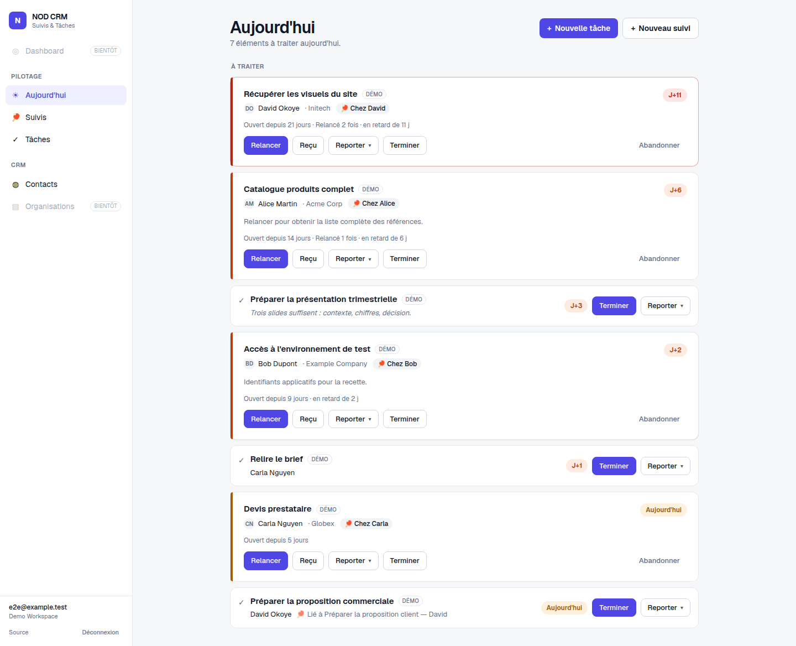
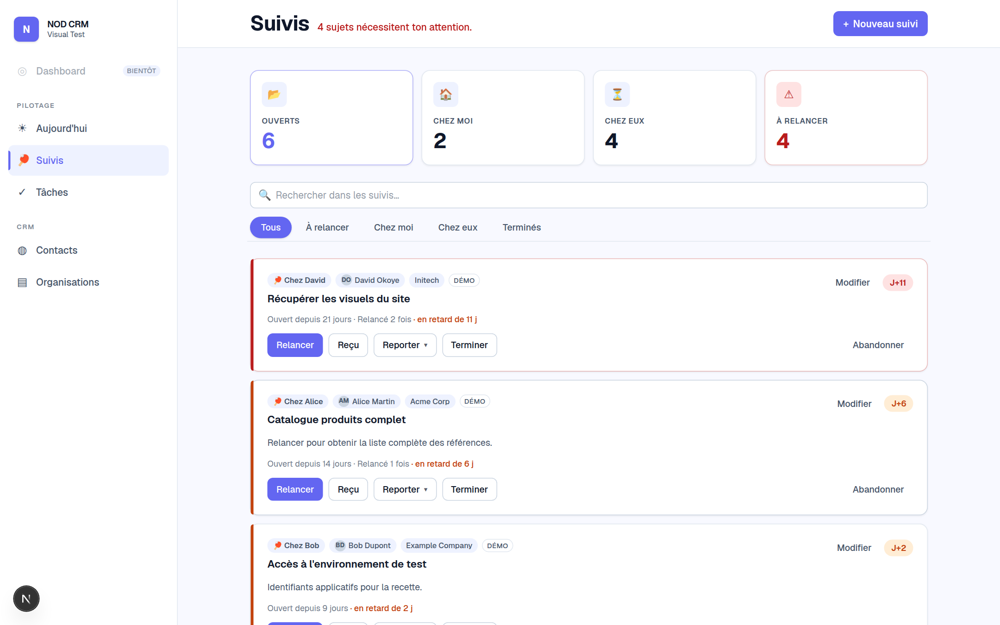
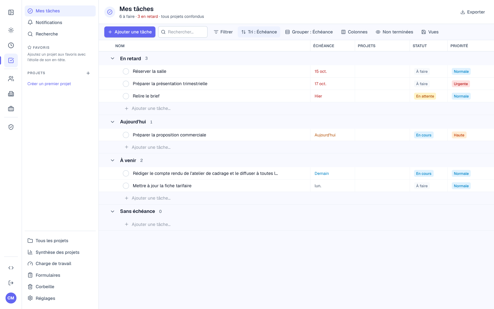

# NOD CRM

[](https://github.com/ious2944/nod-crm/actions/workflows/ci.yml)
[](https://github.com/ious2944/nod-crm/releases)
[](LICENSE)


**CRM open source et auto-hébergé, centré sur les suivis et la prochaine action.**

La plupart des CRM répondent à la question « qui sont mes clients ? ». NOD CRM part d'une question plus petite et plus urgente :

> **Qui dois-je relancer aujourd'hui ?**

Un suivi fait des allers-retours comme une balle de ping-pong : elle est soit **dans votre camp**, soit **dans le leur**. Les tâches couvrent le travail qui doit simplement être fait. Les contacts et les organisations fournissent le contexte des deux. Le cockpit `Aujourd'hui` rassemble en un seul endroit ce qui demande de l'attention maintenant.

> **V1.0 — Gestion de travail** est la version actuelle. Les tâches deviennent un module complet de tâches et projets (projets, sections, vues liste/tableau/calendrier/chronologie, sous-tâches, dépendances, droits par projet, notifications, règles d'automatisation, rappels), toujours construit sur un seul système de tâches et relié aux contacts, organisations et opportunités. Voir le [changelog](CHANGELOG.md). La version précédente, **V0.9 — Commerce**, a ajouté un suivi léger des opportunités ; NOD CRM ne propose toujours ni prévisions, ni scoring des affaires, ni marketing automation.

NOD CRM est un projet jeune, utilisé en production. Lisez les [Limites](#limites) avant de l'adopter. L'interface et ce README sont en français ; le reste de la documentation (`docs/`, `CHANGELOG.md`, `ROADMAP.md`, `CONTRIBUTING.md`, `SECURITY.md`) est en anglais.

---

## Ce qu'est NOD CRM

NOD CRM évite volontairement le modèle du CRM généraliste. Il n'y a ni scoring des affaires, ni prévisions, ni marketing automation.

Ses domaines restent volontairement distincts :

- **Suivis** — quelque chose à faire avancer avec quelqu'un.
- **Tâches et projets** — quelque chose à faire, organisé en projets quand le travail le demande.
- **Contacts** — les personnes concernées.
- **Organisations** — les structures auxquelles ces personnes appartiennent.
- **Commerce** — où en est chaque opportunité commerciale.
- **RGPD Essentials** — le travail de conformité qu'il faut documenter et suivre.

Le produit est organisé autour de la prochaine action utile plutôt qu'autour de la collecte de toujours plus de champs.

---

## Aujourd'hui

`/today` est le cockpit et le point de départ naturel d'une session. Il répond à une seule question : **qu'est-ce qui demande de l'attention maintenant ?**

Il affiche quatre indicateurs d'attention sur les suivis (en retard, aujourd'hui, à venir, chez eux), un fil des suivis prioritaires et les tâches non terminées dont l'échéance est aujourd'hui ou passée — soit toutes les tâches que l'utilisateur peut lire (par défaut), soit uniquement les siennes (« Mes tâches »). Les projets privés et la corbeille sont appliqués côté serveur. Les suivis à venir et en attente restent visibles à côté du fil prioritaire.

Tâches et suivis ont des cycles de vie indépendants : terminer ou reporter l'un ne modifie jamais l'autre en silence.

---

## Fonctionnalités

### Suivis

- Sujet, contexte facultatif, échéance, détenteur de la balle et contact lié facultatif.
- Vieillissement visuel sur cinq niveaux : à venir → demain → aujourd'hui → en retard → plus de 7 jours de retard.
- Statut : ouvert, terminé ou abandonné.
- Actions rapides : Relancer, Reçu, Balle envoyée, Reporter (+1 j / +3 j / +1 sem.), Terminer, Abandonner et Rouvrir.
- Filtres : Tous / À relancer / Chez moi / Chez eux / Terminés.
- Recherche dans le sujet et la description, conservée dans l'URL et compatible avec les filtres.
- Modification après création : sujet, description, échéance et contact lié. Le détenteur de la balle et le statut ne changent que par les actions rapides.

### Tâches et projets (V1.0 — gestion de travail)

Un module de gestion de travail à la manière d'Asana, construit sur **la même table `tasks`** qu'avant — il n'existe qu'un seul système de tâches.

- **Navigation** : Mes tâches (groupées En retard / Aujourd'hui / À venir / Sans échéance), Projets, Notifications, Favoris, ainsi que Recherche, Synthèse des projets, Charge de travail, Formulaires, Corbeille et Réglages.
- **Droits** (vérifiés côté serveur) : projets privés, rôles par projet et droit *gérer* distinct — un responsable qui n'est pas membre du projet peut travailler sur sa tâche mais ne peut ni la réaffecter, ni la partager, ni la déplacer, ni la supprimer, et ne voit jamais le reste du projet. Voir la politique dans [docs/tasks.md](docs/tasks.md#permissions-checked-on-the-server).
- **Projets** : nom, description, couleur, icône, propriétaire, membres et rôles, dates, visibilité (workspace / privé), points d'avancement avec commentaires et historique, favoris, modèles, duplication, archivage, suppression ; les sections peuvent être créées, renommées, réordonnées et supprimées (leurs tâches vont dans une section choisie ou « Sans section », jamais supprimées). Les tâches **et les projets** supprimés vont dans une corbeille et peuvent être restaurés : un projet supprimé conserve ses sections, ses membres et ses tâches (commentaires, fichiers, champs, historique, liens CRM), n'expose jamais les tâches d'un projet privé, et n'est effacé que par une suppression définitive distincte faite par son propriétaire, confirmée sur le périmètre exact calculé par le serveur (revérifié à la confirmation).
- **Vues sur les mêmes données** : Vue d'ensemble, Liste (compacte, sections repliables, colonnes configurables et redimensionnables, édition en ligne, sous-tâches dépliables, ajout rapide, actions groupées sur sélection multiple, menus contextuels, clavier), Tableau (par section ou par statut), Calendrier (mois/semaine, glisser pour replanifier), Chronologie/Gantt (barres, jalons, flèches de dépendance, déplacement/redimensionnement, conflits signalés, décalage en cascade seulement s'il est explicitement activé) et Tableau de bord.
- **Tâches** : description riche, responsable, collaborateurs et abonnés, date de début/d'échéance et heure facultative, statut (À faire / En cours / En attente / Terminé), priorité, tags, champs personnalisés, appartenance à plusieurs projets, sous-tâches, dépendances bloquée par / bloquante (cycles refusés), jalons, récurrence, estimation et suivi du temps, pièces jointes, commentaires avec @mentions et réactions, historique des modifications, circuit d'approbation, lien direct `/tasks/t/<id>`.
- **Collaboration** : notifications dans l'application avec lu/non lu/archivé et préférences par type ; rafraîchissement en temps réel des vues des autres utilisateurs (PostgreSQL LISTEN/NOTIFY → SSE) ; les modifications concurrentes sont détectées champ par champ au lieu d'être écrasées en silence.
- **Automatisation** : règles déclencheur → conditions → actions, enregistrées, tracées, idempotentes par événement et protégées contre les boucles, n'agissant qu'avec les droits actuels de la personne qui les a enregistrées ; modèles de tâches et de projets ; formulaires de demande internes ; import/export CSV ; synthèse multi-projets ; charge de travail par responsable sur une période choisie, comparée à la capacité hebdomadaire de chacun ; rappels d'échéance planifiés.
- **Intégration CRM** : tâches et projets se lient à un contact, une organisation ou une opportunité ; leurs fiches affichent le travail lié et permettent une création rapide.

Voir [docs/tasks.md](docs/tasks.md).

### Contacts

- Annuaire dédié sur `/contacts`, avec création, consultation et modification.
- Prénom, nom, organisation, fonction, e-mail, téléphone, notes et photo facultative.
- Recherche PostgreSQL sur le nom, l'e-mail, le téléphone, la fonction et l'organisation.
- Filtres par organisation et par état de suivi, quatre tris et pagination côté serveur.
- Fiche contact avec les suivis liés et un raccourci pour créer un suivi avec ce contact présélectionné.
- Archivage et restauration plutôt que suppression destructive. L'historique des suivis existants est conservé.

### Organisations

- Organisations à part entière sur `/organizations`.
- Nom, site web, e-mail, téléphone et notes.
- Recherche instantanée, filtre d'archivage et pagination.
- Fiche organisation sur `/organizations/[id]` avec les contacts liés, les suivis ouverts, les tâches ouvertes et les opportunités ouvertes.
- Archivage et restauration.
- Les contacts sont reliés aux organisations par une clé étrangère facultative ; la compatibilité avec l'ancien champ texte « organisation » est conservée.
- L'isolation par workspace s'applique aux lectures, écritures et relations des organisations.

Voir [docs/organizations.md](docs/organizations.md).

### Commerce

- Liste des opportunités sur `/commerce` avec filtres ouvertes/fermées/toutes et compteurs du pipeline, paginée par 25.
- Champs d'une opportunité : nom, organisation liée (obligatoire), contact facultatif, montant estimé, date de clôture prévue, étape du pipeline et notes.
- Pipeline en cinq étapes : À qualifier → En discussion → Proposition → Gagnée / Perdue. Les transitions sont contrôlées côté serveur ; renvoyer l'étape déjà active est sans effet (idempotent).
- Fiche opportunité sur `/commerce/[id]` avec les commandes du pipeline, modification, suppression, et les tâches et suivis liés.
- Création d'une tâche ou d'un suivi directement depuis une opportunité, avec l'opportunité présélectionnée.
- Supprimer une opportunité conserve les tâches et suivis liés (`ON DELETE SET NULL`).
- L'isolation par workspace s'applique à toutes les lectures, écritures et relations des opportunités.

### Données personnelles / RGPD Essentials — V0.8

L'espace `/rgpd` est volontairement un **espace de travail de mini-DPO**, pas une suite d'automatisation juridique.

Il comprend cinq briques :

1. **Registre des traitements** — finalité, personnes concernées, catégories de données, base légale, durée de conservation, destinataires, transferts, mesures de sécurité et dates de revue.
2. **Sous-traitants** — service, localisation, statut EEE, statut du DPA, sous-traitants ultérieurs et dates de revue. Les sous-traitants peuvent être liés aux traitements.
3. **Demandes des personnes** — accès, rectification, effacement, opposition, limitation, portabilité ou autre, avec échéances et suivi du statut.
4. **Incidents / violations** — date de découverte, données touchées, nombre approximatif de personnes, conséquences, mesures, évaluation du risque et décisions de notification.
5. **Cockpit RGPD** — alertes orientées action : base légale ou durée de conservation manquante, problèmes de DPA, revues en retard, demandes de droits et incidents encore à évaluer.

NOD CRM n'affiche jamais « votre entreprise est conforme au RGPD ». Il met en évidence ce qui est documenté et ce qui demande encore de l'attention. Voir [docs/rgpd-essentials.md](docs/rgpd-essentials.md).

### Interface — V0.7

La V0.7 est le système visuel utilisé par tous les modules, RGPD Essentials compris :

- Design system Lumina Enterprise avec jetons sémantiques et Electric Indigo (`#6366F1`) comme couleur principale.
- Typographie Geist et système cohérent d'espacements, d'arrondis et d'élévations.
- Barre latérale de bureau revue et navigation mobile adaptative, avec des icônes vectorielles Lucide pour toutes les entrées.
- En-têtes de page translucides et fixes sur les pages de l'application.
- Cartes, pastilles de filtre, états de focus des formulaires et avatars de contact homogènes.
- Parité des jetons en mode sombre via `prefers-color-scheme`.
- Boîtes de dialogue rendues au niveau du document, accessibles et défilables sur les écrans courts et mobiles.

### Plateforme

- **Authentification** — e-mail/mot de passe, Argon2id, sessions côté serveur avec expiration absolue et d'inactivité, limitation de débit.
- **Isolation par workspace** — le workspace est déduit côté serveur de la session authentifiée, jamais d'une donnée envoyée par le client.
- **CLI d'administration** — création de workspaces et d'utilisateurs, réinitialisation de mot de passe, désactivation de comptes. Les mots de passe sont saisis de façon interactive.
- **Auto-hébergement** — Docker Compose, PostgreSQL 16 et migrations Prisma automatiques.
- **Données de démonstration** — organisations, contacts, suivis, tâches et opportunités fictifs pour un workspace de démo dédié. Les lignes créées par le seed sont identifiables comme données de démo quand le modèle le permet.
- **Journal d'audit des écritures** — chaque écriture passant par une Server Action ajoute une ligne à `audit_logs` : qui, quelle entité, quelle opération, quand. Aucune valeur de champ ni aucun diff n'est stocké. Limité au workspace. Voir [`src/lib/audit/README.md`](src/lib/audit/README.md).

Pas encore construit et absent de la navigation : un tableau de bord CRM global (la vue Tableau de bord d'un projet, elle, existe).

---

## Principes

- **Simplicité.** Une fonctionnalité doit résoudre un vrai problème sans rendre le produit plus difficile à comprendre.
- **La prochaine action d'abord.** Les suivis et le travail qui demande de l'attention passent avant le cérémonial du CRM.
- **Auto-hébergement.** Une application, une base PostgreSQL, ni file de messages ni cache nécessaires.
- **Maîtrise de vos données.** Les administrateurs décident où vivent les données de l'application et qui peut y accéder.
- **Pas de télémétrie cachée.** NOD CRM n'envoie ni statistiques d'usage ni télémétrie.
- **Un outil de conformité, pas une certification juridique.** RGPD Essentials aide à mener le travail de conformité ; il ne tire pas de conclusions juridiques à la place de l'utilisateur.

---

## Captures d'écran

### Aujourd'hui



Le cockpit rassemble ce qui demande de l'attention maintenant : suivis prioritaires, tâches dues aujourd'hui ou en retard, éléments à venir et travail en attente chez quelqu'un d'autre.

### Suivis



Le tableau des suivis garde la prochaine action visible, avec indicateurs d'attention, recherche, filtres par détenteur de la balle et actions rapides dans une seule vue.

### Tâches



« Mes tâches » rassemble toutes les tâches qui vous sont affectées, tous projets confondus, groupées par échéance (en retard, aujourd'hui, à venir, sans échéance), avec statut et priorité, ajout rapide en ligne, filtres, regroupement, colonnes configurables et vues enregistrées.

Toutes les captures utilisent uniquement des données de démonstration fictives. Voir [docs/screenshots/README.md](docs/screenshots/README.md).

---

## Démarrage rapide

Il vous faut [Docker](https://docs.docker.com/get-docker/) avec le plugin Compose, et `openssl`.

```bash
git clone https://github.com/ious2944/nod-crm.git
cd nod-crm
./scripts/init-env.sh
docker compose up -d
```

Cela construit l'image, démarre PostgreSQL, applique les migrations et lance l'application sur `http://localhost:3000`.

`init-env.sh` est une commodité, pas une obligation. `cp .env.example .env` puis la saisie manuelle des secrets fonctionne aussi. Pour les générer :

```bash
openssl rand -base64 48                              # AUTH_SECRET
openssl rand -base64 36 | tr -d '/+=' | cut -c1-40   # POSTGRES_PASSWORD
```

### Créer le premier compte

Aucun identifiant n'est créé par défaut. Les comptes se créent à la main, de façon interactive :

```bash
docker compose exec app node scripts/admin.mjs create-workspace
docker compose exec app node scripts/admin.mjs create-user
```

Ouvrez ensuite `http://localhost:3000` et connectez-vous.

### Facultatif : données de démonstration

```bash
docker compose exec app npx tsx prisma/seed.ts
```

Le seed actuel crée **4 organisations, 4 contacts, 7 suivis, 6 tâches et 5 opportunités fictifs** dans le workspace de démo choisi. Le relancer remplace les données de démo de ce workspace. Il ne crée jamais d'identifiants de connexion.

Le seed refuse de s'exécuter avec `NODE_ENV=production`, sauf si `ALLOW_DEMO_SEED=1` est explicitement défini. Pour un workspace de démo dédié, `SEED_WORKSPACE_SLUG` et `SEED_WORKSPACE_NAME` remplacent les valeurs par défaut.

### Migrations

Le service `migrate` exécute `prisma migrate deploy` avant le démarrage de l'application, à chaque `docker compose up`. Il n'y a rien à lancer à la main.

Mise à jour d'une base qui a fait tourner une préversion de la branche de gestion de travail V1.0 : lancez d'abord `node scripts/migration-check.mjs` (lecture seule). Le script indique dans lequel des trois états se trouve la base, vérifie la structure du schéma par rapport aux migrations appliquées (reconstruites dans une base de référence isolée : le rôle doit avoir `CREATEDB`, ou bien définissez `SHADOW_DATABASE_URL` vers une base vide), liste les lignes qui feraient échouer une migration en attente et, pour le seul état qui l'exige, réconcilie l'historique des migrations **sans réinitialisation et sans perte de données**. Code de sortie 0 : déployer ; 3 : une action est d'abord nécessaire ; 1 : ne pas déployer ; 2 : la vérification n'a pas pu s'exécuter. Voir [docs/tasks.md](docs/tasks.md#upgrade-path-by-initial-state).

---

## Prérequis

| | Auto-hébergement avec Docker | Développement local |
| --- | --- | --- |
| Docker | Engine + plugin Compose | facultatif |
| Node.js | inutile sur l'hôte | 20.9+ (22 en CI et dans l'image) |
| PostgreSQL | fourni par la stack | 16, accessible |
| RAM | ~1,5 Go pour toute la stack | — |
| Disque | ~3 Go pour l'image et son cache de build | — |

HTTPS est obligatoire en production : les cookies de session sont `Secure`, il est donc impossible de se connecter à une instance servie en HTTP simple. Voir [docs/self-hosting.md](docs/self-hosting.md).

---

## Variables d'environnement

Toutes les variables sont documentées dans [`.env.example`](.env.example). Résumé :

| Variable | Obligatoire | Rôle |
| --- | --- | --- |
| `POSTGRES_USER` / `POSTGRES_PASSWORD` / `POSTGRES_DB` | oui | Identifiants de la base. Compose en déduit `DATABASE_URL`. |
| `AUTH_SECRET` | oui | Poivre HMAC des jetons de session, 32 caractères minimum. La production refuse une valeur absente ou d'exemple. |
| `DATABASE_URL` | dev uniquement | Chaîne de connexion directe hors Docker. |
| `APP_NAME` | non | Nom affiché dans l'interface. Par défaut `NOD CRM`. |
| `APP_SOURCE_URL` | non | Cible du lien « Source ». À pointer vers votre fork lorsque l'AGPL §13 l'exige. |
| `APP_TIME_ZONE` | non | Fuseau horaire des échéances à la journée et des rappels. Par défaut `Europe/Paris`. |
| `NOD_SCHEDULER` | non | `off` désactive le minuteur de rappels d'échéance de cette instance. Par défaut `on`. |
| `TASK_REMINDER_INTERVAL_MINUTES` | non | Période du job de rappels, 1 à 60 minutes. Par défaut `5`. |
| `TASK_REMINDER_LEASE_SECONDS` | non | Bail du job de rappels, 30 à 3600 s : délai de reprise après un crash en cours d'exécution. Par défaut `600`. |
| `APP_HOST_PORT` / `APP_BIND_ADDRESS` | non | Adresse publiée. Par défaut `127.0.0.1:3000`. |
| `POSTGRES_VOLUME_NAME` | non | Volume Docker contenant les données PostgreSQL. |
| `UPLOADS_VOLUME_NAME` | non | Volume Docker des fichiers déposés (photos de contact, pièces jointes des tâches). Par défaut `nod-crm-uploads-data`. |
| `NOD_UPLOAD_DIR` | non | Dossier des fichiers déposés hors Docker. Par défaut `var/uploads` dans le projet ; fixé à `/app/var/uploads` dans le conteneur. |
| `TEST_DATABASE_URL` | tests uniquement | Base séparée pour les tests d'intégration ; la suite la vide. |

Changer `AUTH_SECRET` invalide toutes les sessions existantes.

---

## Développement

```bash
cp .env.example .env         # adaptez DATABASE_URL à votre PostgreSQL
npm install
npm run db:migrate
npm run dev                  # http://localhost:3000
```

Si vous préférez ne pas installer PostgreSQL :

```bash
docker compose -f docker-compose.dev.yml up -d
docker compose -f docker-compose.dev.yml exec app npm run db:migrate
```

Plus de détails dans [docs/development.md](docs/development.md).

---

## Tests

```bash
npm run lint
npm run typecheck
npm test
npm run test:integration     # nécessite TEST_DATABASE_URL — vide cette base
npm run build
```

Les suites navigateur et CLI nécessitent une instance en marche et un compte :

```bash
BASE_URL=http://127.0.0.1:3000 E2E_EMAIL=you@example.com E2E_PASSWORD='…' npm run test:e2e
npm run test:e2e:work         # parcours tâches et projets de la V1.0
npm run test:cli
```

`npm test` nécessite le client Prisma généré — lancez d'abord `npm run db:generate` sur un clone neuf.

---

## Sécurité

NOD CRM authentifie les requêtes côté serveur et déduit le workspace de la session, jamais de ce qu'envoie le client. RGPD Essentials suit la même règle : chaque enregistrement est limité par `workspace_id`, et les identifiants étrangers fournis par le client sont revérifiés dans ce workspace avant toute création de relation.

Le modèle de menace, les contrôles et les risques résiduels sont documentés dans [docs/security-model.md](docs/security-model.md).

Pour signaler une vulnérabilité, lisez [SECURITY.md](SECURITY.md). N'ouvrez pas d'issue publique pour cela.

---

## Limites

Connues et assumées en V1.0 :

- Pas de MFA. Un mot de passe volé suffit. Le modèle de données est prêt ; la fonctionnalité n'est pas construite.
- Pas de rôles au niveau du workspace. En dehors des tâches et projets (qui ont des projets privés et des rôles par projet), un utilisateur authentifié peut tout faire dans son workspace.
- La réinitialisation de mot de passe passe par la CLI, pas par un libre-service.
- L'isolation multi-workspace est appliquée, mais il n'existe pas d'interface pour créer un workspace ou en changer, hors CLI.
- « Relancer » enregistre la relance ; aucun e-mail n'est envoyé. NOD CRM n'envoie aujourd'hui aucun e-mail.
- Le tableau des suivis n'est pas paginé ; les éléments de l'onglet actif sont chargés en entier depuis la base. Ses statistiques sont calculées par la base. Contacts et Commerce sont paginés.
- La recherche dans les suivis ouverts se fait en mémoire ; l'onglet des suivis terminés utilise `ILIKE` de PostgreSQL. Il n'y a pas encore d'index plein texte ou trigramme.
- La recherche de contacts utilise `ILIKE` ; `pg_trgm` n'est pas encore livré.
- Les photos de contact et les pièces jointes des tâches sont stockées sur un volume, pas dans PostgreSQL. La sauvegarde les inclut, mais leur restauration reste une étape manuelle ; voir [docs/backup-restore.md](docs/backup-restore.md).
- Les suivis sont modifiables, mais le détenteur de la balle et le statut ne changent que par les actions rapides.
- Aucune notification par e-mail : NOD CRM n'a pas encore de transport de courrier. Les notifications sont uniquement dans l'application.
- Les rappels d'échéance tournent sur un minuteur interne au processus (toutes les 5 minutes par défaut), protégé par un bail en base ; ils sont dédupliqués, repris après interruption et jamais envoyés pour une échéance passée. Ils sont uniquement dans l'application. Un processus arrêté au moment du rappel l'envoie à l'exécution suivante, tant que l'échéance n'est pas passée. Après un crash en cours d'exécution, une autre instance prend le relais à l'expiration du bail (10 minutes par défaut).
- La capacité de charge est réglée par chaque utilisateur pour lui-même ; aucun rôle d'administrateur ne permet de la régler pour les autres.
- Les sous-tâches n'ont qu'un niveau. Les grandes listes de projet s'affichent progressivement (150 lignes par section, « afficher plus ») plutôt qu'avec une virtualisation complète.
- Les actions rapides nécessitent JavaScript. L'écran de connexion, non.
- L'interface n'existe qu'en français.
- **RGPD Essentials est une aide opérationnelle, pas un conseil juridique, une certification, un outil d'AIPD/DPIA, une plateforme de gestion du consentement ni une analyse automatisée du droit des transferts.**
- Bases légales, durées de conservation, statut des DPA, analyses des transferts internationaux et décisions de notification des violations sont documentés par l'utilisateur ; NOD CRM ne les choisit pas automatiquement.

---

## Feuille de route

Des orientations, pas des engagements. La feuille de route complète se trouve dans [ROADMAP.md](ROADMAP.md).

- **V0.1 — Suivis — livrée.** Flux de suivi de base, authentification et auto-hébergement.
- **V0.2 — Contacts — livrée.** Annuaire, recherche, filtres, pagination, photos et archivage.
- **V0.3 — Aujourd'hui — livrée.** Cockpit orienté action pour ce qui demande de l'attention maintenant.
- **V0.4 — Tâches — livrée.** Un objet tâche distinct et un cockpit Aujourd'hui qui tient compte des tâches.
- **V0.5 — Organisations — livrée.** Organisations à part entière et relation Contact → Organisation.
- **V0.6 — Recherche et modification des suivis — livrée.** Recherche et modification sûre du contenu des suivis.
- **V0.7 — Refonte de l'interface Lumina Enterprise — livrée.** Système visuel unifié, ajustements responsive, parité du mode sombre et boîtes de dialogue adaptées à l'écran ; aucune nouvelle logique métier.
- **V0.8 — RGPD Essentials — livrée.** Registre des traitements, sous-traitants, demandes de droits, incidents et alertes RGPD.
- **V0.9 — Commerce — livrée.** Suivi léger des opportunités, pipeline en cinq étapes et intégration avec les tâches et suivis existants.
- **V1.0 — Gestion de travail — actuelle.** Tâches et projets : projets et sections, vues multiples, sous-tâches, dépendances, récurrence, droits par projet, corbeille, notifications, règles d'automatisation, rappels planifiés, import/export CSV des tâches.

**Ensuite.** Import/export CSV des contacts, amélioration des index de recherche (`pg_trgm`), amorce d'une interface en anglais, raccourcis clavier plus complets et notifications par e-mail restent des pistes, pas des engagements.

Pistes plus lointaines : historique et fusion des doublons de contacts, historique par suivi, MFA, réinitialisation du mot de passe en libre-service, invitations multi-utilisateurs, pagination des suivis à plus grande échelle et API publique/webhooks.

Volontairement hors périmètre pour longtemps : scoring des affaires, prévisions, marketing automation, systèmes de plugins et fonctionnalités d'IA qui devinent ce que vous devriez faire.

---

## Contribuer

Les contributions sont bienvenues, en particulier les signalements de bugs, la documentation et les petits correctifs ciblés. Lisez d'abord [CONTRIBUTING.md](CONTRIBUTING.md) : la règle centrale est de **garder NOD CRM simple**.

En participant, vous acceptez le [Code de conduite](CODE_OF_CONDUCT.md).

---

## Licence

NOD CRM est distribué sous la **GNU Affero General Public License v3.0 uniquement** ([AGPL-3.0-only](LICENSE)).

Vous pouvez l'exécuter, le modifier et l'auto-héberger. Si vous modifiez NOD CRM et laissez d'autres personnes utiliser votre instance via un réseau, la section 13 de l'AGPL vous oblige à leur proposer le code source correspondant. Pointez `APP_SOURCE_URL` vers votre dépôt le cas échéant.

Les dépendances tierces conservent leurs propres licences ; aucune n'a été modifiée.

---

**Construire. Ouvrir. Expliquer. Améliorer.**
